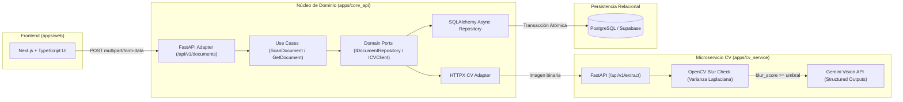

## Contexto y Problema

La digitalización contable de recibos y facturas físicas suele fallar en producción por dos razones recurrentes:

1. **Costos innecesarios de inferencia:** Enviar fotografías desenfocadas, movidas o ilegibles directamente a modelos de visión multimodal consume cuota de API sin producir datos útiles.
2. **Acoplamiento entre reglas de negocio e infraestructura:** Cuando la lógica de persistencia, los clientes de IA y los controladores HTTP están mezclados en un solo servicio monolítico, sustituir el proveedor de visión o probar la lógica de dominio en aislamiento se vuelve costoso y frágil.

**doc-scan-monorepo** resuelve ambos desafíos separando responsabilidades en un monorepo políglota con un filtro determinista de calidad óptica en OpenCV previo a la inferencia estructurada, orquestado desde un núcleo de dominio bajo Arquitectura Hexagonal.

## Arquitectura del Sistema

El monorepo integra tres aplicaciones contenerizadas (`web`, `core_api` y `cv_service`) que se comunican mediante contratos HTTP estrictamente tipados:

## Decisiones Técnicas Clave

- **Arquitectura Hexagonal (Puertos y Adaptadores) en `core_api`:** El paquete `src/domain/` contiene únicamente entidades puras y contratos abstractos (`IDocumentRepository`, `ICVClient`) sin ninguna dependencia de FastAPI, SQLAlchemy ni HTTPX. Los casos de uso en `src/application/` orquestan el flujo y delegan los detalles técnicos a `src/infrastructure/`.
- **Filtro Óptico Previo con OpenCV en `cv_service`:** Antes de invocar la API de Gemini, el microservicio calcula la varianza del operador Laplaciano (`cv2.Laplacian`) sobre la imagen en escala de grises y normaliza sus dimensiones (máximo 1920px). Si el puntaje de nitidez es inferior al umbral configurado, rechaza inmediatamente la petición con `422 Unprocessable Content (IMAGE_TOO_BLURRY)`, ahorrando latencia y costos de tokens.
- **Salidas Estructuradas y Transacciones Atómicas:** `cv_service` fuerza un esquema JSON tipado (*Structured Outputs*) para extraer comercio, NIT, fecha, moneda, impuestos e ítems. Al recibir la respuesta, `core_api` abre una transacción asíncrona con `asyncpg` e inserta de forma atómica la cabecera en `documents` y el lote en `document_items`.
- **Consultas sin Problema N+1:** La recuperación de documentos individuales y listados paginados utiliza cargas ansiosas optimizadas (`selectinload` / `JOIN`) e índices sobre `created_at` y `document_id`.

## Seguridad y Calidad

- **Contenedores Multi-Etapa sin Privilegios (Non-Root):** Tanto `core_api` como `cv_service` emplean builds multi-etapa con `uv` para compilar el entorno virtual en `/opt/venv` y ejecutar el proceso en una imagen `python:3.11-slim` limpia bajo un usuario de sistema sin privilegios (`appuser`, UID `10001`).
- **Validación Defensiva de Archivos:** Verificación estricta de cabeceras MIME (`image/jpeg`, `image/png`, `image/webp`) y límite estricto de 5 MB antes de procesar el buffer en memoria volátil, sin almacenar imágenes sensibles en disco.
- **Automatización de Calidad (CI):** Pipeline en GitHub Actions y hooks de `pre-commit` que ejecutan análisis estático y formateo con **Ruff**, además de suites de pruebas unitarias y asíncronas con **Pytest** (`pytest-asyncio`).

## Repositorios del Ecosistema

- **Monorepo Completo (`doc-scan-monorepo`):** [https://github.com/DevAvirama/doc-scan-monorepo](https://github.com/DevAvirama/doc-scan-monorepo)
  - Especificación `cv_service`: `docs/specs/01_cv_service_spec.md`
  - Especificación `core_api`: `docs/specs/02_core_api_spec.md`
