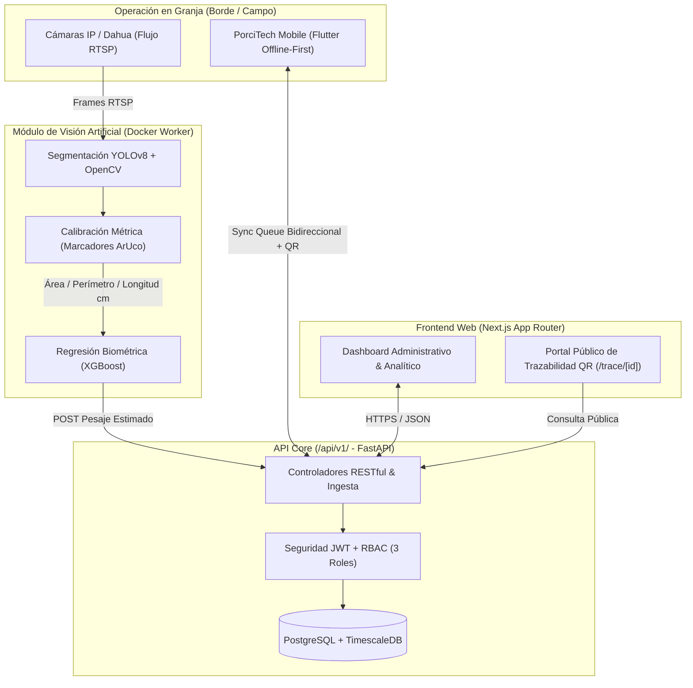

## Contexto y Problema

En la industria porcícola tradicional, el control de ganancia diaria de peso (GDP), la trazabilidad sanitaria y el seguimiento reproductivo enfrentan dos obstáculos críticos:

1. **Estrés y riesgo biológico en el pesaje manual:** Conducir a los animales hacia básculas mecánicas genera estrés agudo, pérdida temporal de peso, lesiones físicas y riesgos ergonómicos para los operarios.
2. **Desconexión en zonas rurales:** Los galpones de producción suelen carecer de cobertura estable de internet, lo que provoca registros en papel propensos a extravío y transcripciones tardías.

**PorciTech** nace como un ecosistema tecnológico integral que digitaliza la operación en granja de extremo a extremo, combinando captura móvil offline-first en corral con inferencia de visión por computador sin contacto.

## Arquitectura del Sistema

El sistema está diseñado como una arquitectura distribuida de 4 módulos especializados que convergen sobre un núcleo transaccional y analítico:

## Decisiones Técnicas Clave

- **Estimación de Peso sin Contacto (YOLOv8 + ArUco + XGBoost):** En lugar de depender de una distancia fija de cámara, el pipeline visual detecta marcadores fiduciarios **ArUco** en el corral para calcular dinámicamente la relación píxel-centímetro. Con la máscara de segmentación dorsal obtenida por **YOLOv8**, se extraen descriptores morfométricos reales (área dorsal, perímetro, longitud y anchura) que alimentan un modelo **XGBoost** entrenado para estimar la masa corporal con baja latencia.
- **Persistencia Híbrida (PostgreSQL + TimescaleDB):** Los catálogos zootécnicos, lotes, ciclos reproductivos e inventarios residen en tablas relacionales normalizadas, mientras que las lecturas continuas de pesaje biométrico y telemetría se almacenan en hipertablas de **TimescaleDB** para optimizar consultas agregadas por ventana temporal.
- **Operación Móvil Offline-First en Flutter:** La aplicación móvil prioriza el almacenamiento local y encola las mutaciones con identificadores únicos (UUID) y marcas de tiempo UTC, sincronizando automáticamente las novedades cuando el operario regresa a una zona con cobertura Wi-Fi.
- **Arquitectura Frontend Orientada a Dominios (Feature-Driven):** El cliente web en Next.js organiza sus componentes, servicios y estados por dominios funcionales (`animals`, `weight`, `reproduction`, `health`, `feeding`, `inventory`), facilitando el escalado independiente y la trazabilidad mediante códigos QR.

## Seguridad y Calidad

- **Control de Acceso Basado en Roles (RBAC):** La API Core implementa autorización granular en 3 niveles (*Administrador*, *Veterinario / Zootecnista* y *Operario de Campo*), protegiendo las rutas críticas mediante tokens JWT firmados.
- **Versionado y Validación Estricta de Contratos:** Todos los endpoints bajo `/api/v1/` validan sus cargas de entrada y salida con esquemas Pydantic v2, evitando inyecciones de datos malformados desde clientes externos o workers de visión.
- **Aislamiento en Contenedores:** El worker de procesamiento RTSP y el servicio de inferencia se ejecutan en contenedores Docker con dependencias fijadas, garantizando la reproducibilidad del entorno matemático y de visión artificial.

## Repositorios del Ecosistema

- **Frontend Web (`porcitech-nextjs`):** [https://github.com/DevAvirama/porcitech-nextjs](https://github.com/DevAvirama/porcitech-nextjs)
- **API Core (`api_porcitech`):** [https://github.com/DevAvirama/api_porcitech](https://github.com/DevAvirama/api_porcitech)
- **Visión Artificial (`Vision_Artificial`):** [https://github.com/DevAvirama/Vision_Artificial](https://github.com/DevAvirama/Vision_Artificial)
- **App Móvil (`porcitech_mobile`):** [https://github.com/DevAvirama/porcitech_mobile](https://github.com/DevAvirama/porcitech_mobile)
